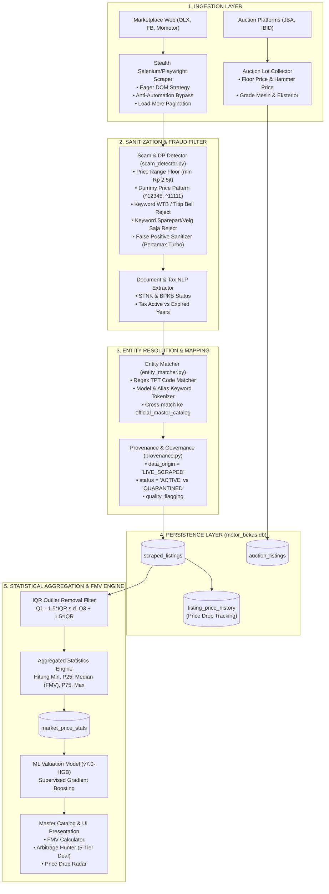
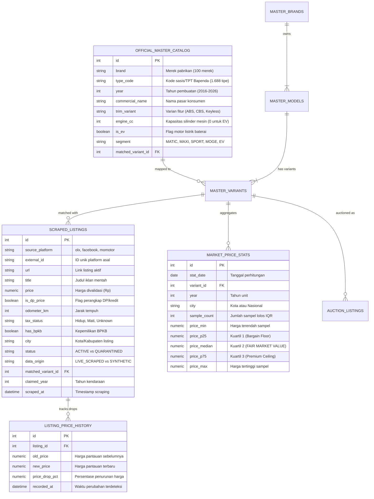

# Dokumentasi Arsitektur Pipeline Data, Basis Data, dan Orkestrasi Apache Airflow (MotorPrice ID)

Dokumen ini menyajikan panduan teknis dan spesifikasi sistem end-to-end mengenai:
1. **Arsitektur Pipeline Penarikan Data (Data Ingestion & Extraction)**
2. **Kamus Data & Spesifikasi Parameter Basis Data (Data Dictionary & ERD)**
3. **Alur Relasi Penarikan Data Menuju Pembaruan Harga Pasar (*Master Price Update Flow*)**
4. **Desain Kompilasi Multi-Pipeline Menggunakan Apache Airflow (Motor, Smartphone/HP, Laptop)**

---

## 1. Arsitektur End-to-End Pipeline

Diagram berikut mengilustrasikan perjalanan data dari proses *crawling* mentah hingga memperbarui nilai pasar wajar (*Fair Market Value*) pada katalog master:



---

## 2. Kamus Data & Spesifikasi Parameter Basis Data

Basis data operasional menggunakan SQLite / PostgreSQL dengan relasi terindeks tinggi:



### Parameter Kunci Pemfilteran & Sanitasi:
1. **`is_dp_price = 0`**: Menyaring iklan yang memasang harga DP (misal Rp 1.500.000 untuk NMAX).
2. **`status = 'ACTIVE'`**: Hanya data yang lolos uji anomali statistik MAD dan batas logis usia kendaraan.
3. **`data_origin = 'LIVE_SCRAPED'`**: Menjamin hanya data riil yang dipakai melatih model valuasi machine learning.
4. **`IQR Outlier Floor & Ceiling`**:
   $$\text{IQR} = Q_3 - Q_1$$
   $$\text{Lower Bound} = \max(\text{Rp 2.500.000}, Q_1 - 1.5 \times \text{IQR})$$
   $$\text{Upper Bound} = Q_3 + 1.5 \times \text{IQR}$$

---

## 3. Alur Pembaruan Data Harga Master (*Price Update Engine*)

Proses updating harga tidak menimpa data historis, melainkan melalui tahapan agregasi berjenjang:

1. **Deteksi Perubahan Harga Individu (*Price Drop Tracker*)**:
   - Jika listing dengan `external_id` yang sama ditemukan kembali dengan harga lebih rendah:
     $$\Delta P = \frac{P_{\text{old}} - P_{\text{new}}}{P_{\text{old}}} \times 100\%$$
   - Baris baru dicatat di tabel `listing_price_history`.
2. **Rekalkulasi Distribusi Pasar Harian (*Daily Aggregation*)**:
   - Query mengambil seluruh listing aktif per kombinasi `(matched_variant_id, claimed_year, city)`.
   - Mengeliminasi harga ekstrem via metode IQR.
   - Menghitung $P_{25}$ (Bargain), $P_{50}$ (**Fair Market Value / Median**), dan $P_{75}$ (Premium).
   - Memasukkan atau memperbarui (*upsert*) ke tabel `market_price_stats`.
3. **Penyelarasan Nilai Katalog Master (*Master Catalog Sync*)**:
   - Varian katalog (`master_variants`) dan tipe sasis (`official_master_catalog`) secara dinamis mereferensikan nilai median terbaru dari `market_price_stats`.

---

## 4. Desain Kompilasi Multi-Pipeline dengan Apache Airflow

Untuk mengintegrasikan pipeline **Sepeda Motor**, **Smartphone / HP**, dan **Laptop** ke dalam satu Master Data Platform, arsitektur dibagi menjadi modul DAG (*Directed Acyclic Graph*) yang modular dan reusable.

### Pola Taksonomi Data Lintas Domain (*Generic Schema Standard*):
| Entitas Standar | Domain Motor | Domain Smartphone (HP) | Domain Laptop |
|---|---|---|---|
| **`master_catalog`** | Sasis, Model, CC, EV | Seri, RAM/Storage, Chipset | Model, Prosessor, RAM/SSD, GPU |
| **`raw_listings`** | Judul, Harga, Odo, Pajak | Judul, Harga, Battery Health, Garansi | Judul, Harga, Kondisi Baterai, Kelengkapan |
| **`price_history`** | Riwayat penurunan harga motor | Riwayat flash sale / promo HP | Riwayat potongan harga laptop |
| **`market_stats`** | P25, Median (FMV), P75 per Tahun | P25, Median, P75 per Varian Storage | P25, Median, P75 per Spek CPU/RAM |

---

### Blueprint Kode DAG Apache Airflow (`master_compilation_dag.py`)

Simpan skrip DAG ini di dalam folder `dags/` Apache Airflow Anda:

```python
"""
Apache Airflow Master Compilation Pipeline
Domain: Motor, Smartphone (HP), dan Laptop Intelligence Platform
"""

from datetime import datetime, timedelta
from airflow import DAG
from airflow.operators.python import PythonOperator
from airflow.operators.bash import BashOperator
from airflow.utils.task_group import TaskGroup

# Default Arguments untuk Pipeline Produksi
default_args = {
    'owner': 'data_platform_team',
    'depends_on_past': False,
    'start_date': datetime(2026, 1, 1),
    'email_on_failure': True,
    'email': ['alert-data@motorprice.id'],
    'retries': 2,
    'retry_delay': timedelta(minutes=5),
    'execution_timeout': timedelta(hours=2),
}

with DAG(
    dag_id='master_multicategory_pricing_pipeline',
    default_args=default_args,
    description='Orkestrasi Terpadu Ingesti, Sanitasi, dan Penentuan Nilai Pasar Wajar (Motor, HP, Laptop)',
    schedule_interval='0 2 * * *', # Dijalankan setiap hari pukul 02:00 WIB
    catchup=False,
    max_active_runs=1,
    tags=['pricing', 'motor', 'gadget', 'airflow', 'master_catalog']
) as dag:

    # ==========================================================================
    # TASK GROUP 1: MOTORCYCLE PIPELINE
    # ==========================================================================
    with TaskGroup(group_id='motorcycle_pipeline') as tg_motor:
        
        t_scrape_motor = BashOperator(
            task_id='scrape_live_motor_olx',
            bash_command='python3 /opt/airflow/scrapers/olx_stealth_scraper.py --limit 1000'
        )

        t_sanitize_motor = BashOperator(
            task_id='sanitize_and_match_motor',
            bash_command='python3 /opt/airflow/pipeline/scam_detector.py --input-latest'
        )

        t_aggregate_motor = BashOperator(
            task_id='aggregate_motor_market_stats',
            bash_command='python3 -c "from analytics.pricing_engine import PricingAnalyticsEngine; from models.database import SessionLocal; db = SessionLocal(); PricingAnalyticsEngine(db).refresh_daily_market_stats(); db.close()"'
        )

        t_train_ml_motor = BashOperator(
            task_id='train_fmv_ml_model',
            bash_command='python3 /opt/airflow/analytics/train_valuation_model.py --scope live'
        )

        t_scrape_motor >> t_sanitize_motor >> t_aggregate_motor >> t_train_ml_motor

    # ==========================================================================
    # TASK GROUP 2: SMARTPHONE / HP PIPELINE
    # ==========================================================================
    with TaskGroup(group_id='smartphone_pipeline') as tg_hp:
        
        t_scrape_hp = BashOperator(
            task_id='scrape_ecommerce_smartphone',
            bash_command='python3 /opt/airflow/scrapers/gadgets/scrape_smartphones.py'
        )

        t_normalize_hp = BashOperator(
            task_id='resolve_hp_specs_and_storage',
            bash_command='python3 /opt/airflow/pipeline/gadgets/match_hp_specs.py'
        )

        t_aggregate_hp = BashOperator(
            task_id='aggregate_hp_fair_price',
            bash_command='python3 /opt/airflow/analytics/gadgets/aggregate_hp_pricing.py'
        )

        t_scrape_hp >> t_normalize_hp >> t_aggregate_hp

    # ==========================================================================
    # TASK GROUP 3: LAPTOP PIPELINE
    # ==========================================================================
    with TaskGroup(group_id='laptop_pipeline') as tg_laptop:
        
        t_scrape_laptop = BashOperator(
            task_id='scrape_ecommerce_laptop',
            bash_command='python3 /opt/airflow/scrapers/gadgets/scrape_laptops.py'
        )

        t_normalize_laptop = BashOperator(
            task_id='resolve_cpu_ram_gpu_laptop',
            bash_command='python3 /opt/airflow/pipeline/gadgets/match_laptop_specs.py'
        )

        t_aggregate_laptop = BashOperator(
            task_id='aggregate_laptop_fair_price',
            bash_command='python3 /opt/airflow/analytics/gadgets/aggregate_laptop_pricing.py'
        )

        t_scrape_laptop >> t_normalize_laptop >> t_aggregate_laptop

    # ==========================================================================
    # STAGE 4: MASTER CONSOLIDATION & DATA WAREHOUSE SYNC
    # ==========================================================================
    t_master_sync = BashOperator(
        task_id='sync_master_data_warehouse',
        bash_command='python3 /opt/airflow/scripts/sync_all_categories_warehouse.py'
    )

    t_notify_slack = BashOperator(
        task_id='dispatch_daily_pipeline_report',
        bash_command='python3 /opt/airflow/analytics/alert_dispatcher.py --notify-all-categories'
    )

    # Definisi Dependensi Lintas Kategori (Eksekusi Paralel -> Konsolidasi)
    [tg_motor, tg_hp, tg_laptop] >> t_master_sync >> t_notify_slack
```

---

## 5. Ringkasan Implementasi Praktis

1. **Eksekusi Mandiri & Paralel**:
   - Ketiga pipeline (*Motor, HP, Laptop*) dapat berjalan secara paralel dan terisolasi menggunakan `TaskGroup`.
   - Kegagalan scraping pada kategori laptop tidak akan menghentikan rekalkulasi harga motor atau HP.
2. **Konsolidasi Terpadu**:
   - Task `sync_master_data_warehouse` mengumpulkan metrik harga pasar wajar dari ketiga domain dan memperbarui dashboard eksekutif.
3. **Data Integrity & SLA**:
   - Standar sanitasi (deteksi penipuan, pemisahan iklan aksesoris, dan normalisasi entitas) diterapkan seragam di semua kategori sebelum menyentuh tabel statistik kuantil.
